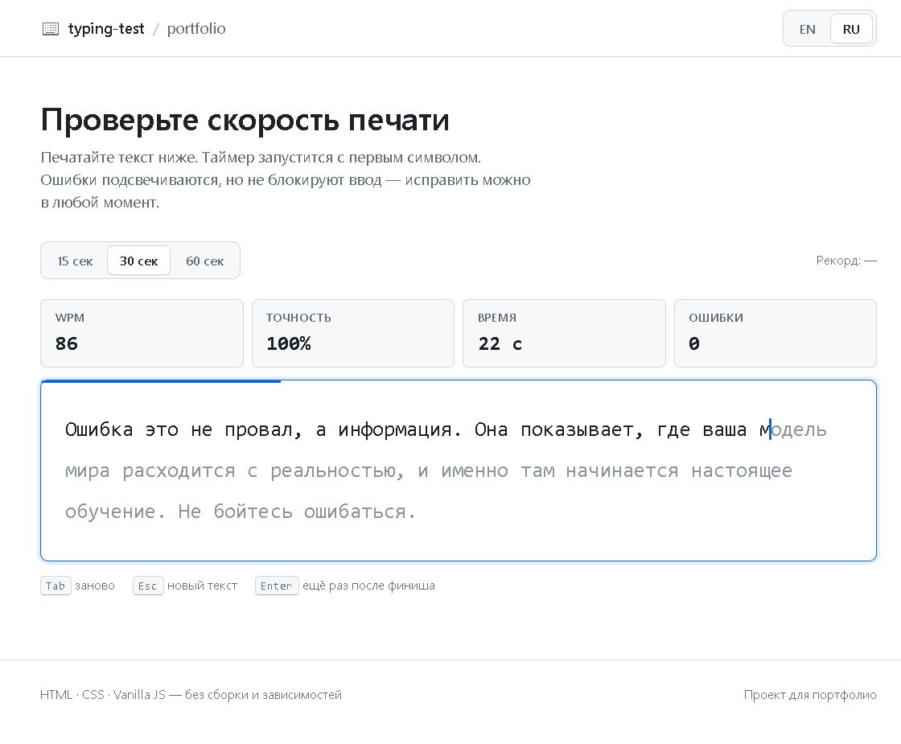
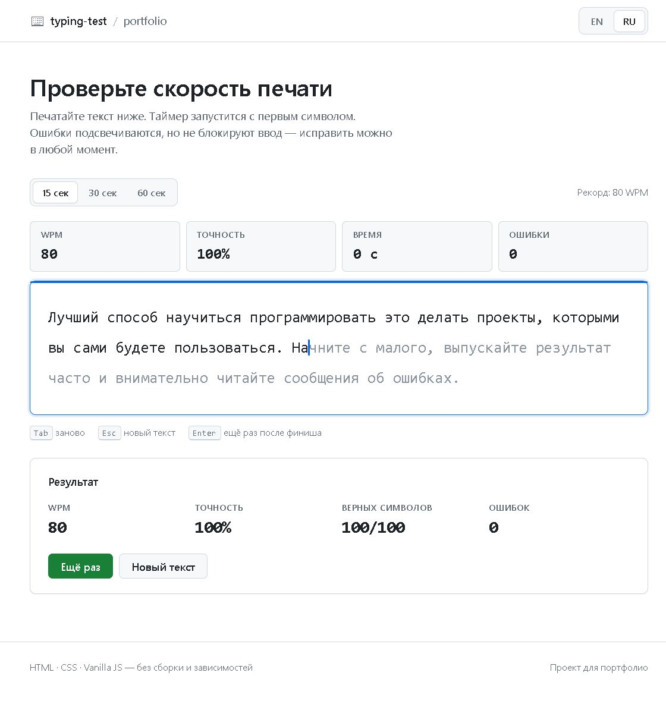

# Typing Speed Test

Минималистичный тест скорости печати в стиле GitHub. Считает WPM, точность и ошибки,
подсвечивает символы в реальном времени и запоминает личные рекорды.

**Стек:** HTML, CSS, Vanilla JS. Без сборки, без зависимостей, без бэкенда.



## Демо

После публикации на GitHub Pages ссылка будет здесь:

```
https://<ваш-ник>.github.io/typing-test/
```

## Возможности

- Тест на 15, 30 и 60 секунд.
- Два языка текстов: русский и английский.
- Живая подсветка: верные символы, ошибки, позиция каретки.
- WPM и точность обновляются во время печати.
- Личный рекорд для каждой комбинации «язык + длительность» хранится в `localStorage`.
- Тёмная тема автоматически, через `prefers-color-scheme`.
- Адаптивная вёрстка и поддержка мобильной клавиатуры.
- Горячие клавиши: `Tab` — заново, `Esc` — новый текст, `Enter` — ещё раз после финиша.

## Экран результатов



## Как запустить

Открыть `index.html` двойным кликом — этого достаточно, сборка не нужна.

Если удобнее через локальный сервер:

```bash
# Python
python -m http.server 8000

# или Node.js
npx serve .
```

Затем открыть `http://localhost:8000`.

## Деплой на GitHub Pages

1. Создайте репозиторий и загрузите файлы проекта.
2. Откройте **Settings → Pages**.
3. В разделе **Build and deployment** выберите **Deploy from a branch**.
4. Укажите ветку `main` и папку `/ (root)`.
5. Через минуту сайт будет доступен по адресу `https://<ник>.github.io/<репозиторий>/`.

## Структура проекта

```
typing-test/
├── index.html          # разметка: шапка, статистика, доска, результаты
├── css/
│   └── style.css       # токены цветов, тёмная тема, адаптив
├── assets/
│   ├── typing.jpg      # скриншот для README
│   └── result.jpg
├── js/
│   ├── texts.js        # банк текстов EN/RU
│   ├── engine.js       # чистая логика: WPM, точность, выбор текста
│   ├── ui.js           # рендер символов, каретка, обновление чисел
│   └── app.js          # состояние, таймер, ввод, localStorage
└── README.md
```

## Как считается статистика

**WPM** (words per minute):

```
WPM = (верно набранные символы / 5) / прошедшие минуты
```

Пять символов — общепринятая длина «слова», поэтому пробелы и знаки препинания
тоже учитываются.

**Точность:**

```
accuracy = (все нажатия - ошибки) / все нажатия × 100%
```

Ошибки считаются в момент ввода. Если стереть неверный символ через Backspace и
напечатать правильно, он всё равно останется в статистике точности — так честнее.

## Технические решения

- **Скрытый `<input>` вместо обработки `keydown`.** Ввод идёт в невидимое поле,
  а интерфейс отражает его значение. Это бесплатно даёт поддержку Backspace,
  мобильных клавиатур и IME, а также позволяет блокировать вставку из буфера.
- **Пословная разметка.** Каждое слово обёрнуто в `span` с `white-space: nowrap`,
  поэтому слова не разрываются между строками, как это бывает при наивной
  посимвольной вёрстке.
- **Инкрементальное обновление.** DOM строится один раз; при вводе меняются только
  CSS-классы символов. Текст автоматически продлевается, если пользователь
  печатает быстрее, чем заканчивается отрывок.
- **Данные из API не используются**, но весь пользовательский текст выводится
  через `textContent`, а не `innerHTML`.

## Планы

- Режим «слова» вместо таймера.
- Настройка пунктуации и цифр.
- График скорости по секундам после финиша.
- Кнопка «Поделиться результатом».
- Сохранение истории забегов, а не только лучшего.

## Лицензия

Учебный проект для портфолио. Используйте код свободно.
